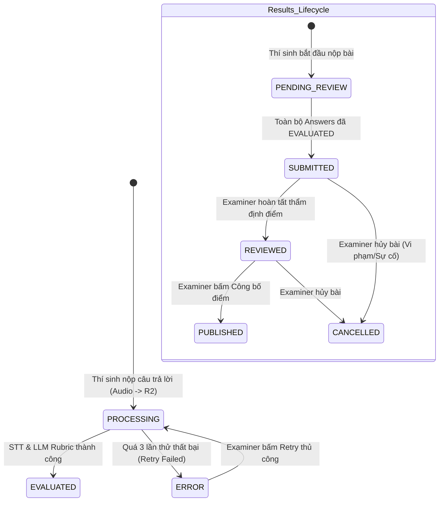

# AIVES — TÀI LIỆU ĐẶC TẢ YÊU CẦU PHẦN MỀM (SRS)
## PHẦN 2: ĐẶC TẢ CHỨC NĂNG THI, CHẤM ĐIỂM VÀ YÊU CẦU CHẤT LƯỢNG
**Học phần:** SWD392 — Software Architecture and Design  
**Hệ thống:** AIVES (*AI-powered Viva Examination System*)  
**Phiên bản:** 2.0 (Kiến trúc Bất đồng bộ, Cloudflare R2 & Phân tách Nhiệm vụ Khảo thí SoD)  
**Tác giả phụ trách:** Nhóm AIVES — Phân hệ Thi & Chấm điểm (Student & Examiner)  

---

## MỤC LỤC
1. [GIỚI THIỆU VÀ PHẠM VI TÀI LIỆU](#1-giới-thiệu-và-phạm-vi-tài-liệu)
2. [ĐẶC TẢ YÊU CẦU CHỨC NĂNG (FUNCTIONAL REQUIREMENTS)](#2-đặc-tả-yêu-cầu-chức-năng-functional-requirements)
   - 2.1. Phân hệ Thí sinh (Student Subsystem)
   - 2.2. Phân hệ Cán bộ Khảo thí (Examiner Subsystem)
3. [QUY TẮC NGHIỆP VỤ (BUSINESS RULES - BR)](#3-quy-tắc-nghiệp-vụ-business-rules---br)
   - 3.1. Cấu trúc Rubric và Trọng số câu hỏi
   - 3.2. Quy tắc Tính điểm tự động của AI
   - 3.3. Quy tắc Thẩm định, Điều chỉnh điểm (Examiner Override) và Bằng chứng Kiểm toán
   - 3.4. Vòng đời Trạng thái bài thi (State Machine) và Quy tắc Công bố (Publish)
4. [YÊU CẦU PHI CHỨC NĂNG VÀ CHẤT LƯỢNG (NON-FUNCTIONAL REQUIREMENTS - NFR)](#4-yêu-cầu-phi-chức-năng-và-chất-lượng-non-functional-requirements---nfr)
   - 4.1. An toàn & Bảo mật thông tin (Security & Privacy)
   - 4.2. Hiệu năng & Khả năng mở rộng (Performance & Scalability)
   - 4.3. Quản lý Lưu trữ Âm thanh (Audio Storage Architecture)
   - 4.4. Độ tin cậy, Xử lý ngoại lệ và Phục hồi sự cố (Fault Tolerance & Disaster Recovery)
5. [MA TRẬN SO SÁNH: CHỨC NĂNG HIỆN CÓ (AS-IS) VS ĐỀ XUẤT (TO-BE)](#5-ma-trận-so-sánh-chức-năng-hiện-có-as-is-vs-đề-xuất-to-be)
6. [GIỚI HẠN VÀ RÀNG BUỘC HỆ THỐNG (SYSTEM CONSTRAINTS)](#6-giới-hạn-và-ràng-buộc-hệ-thống-system-constraints)

---

## 1. GIỚI THIỆU VÀ PHẠM VI TÀI LIỆU

### 1.1. Mục đích
Tài liệu này đặc tả chi tiết các yêu cầu chức năng (FR), quy tắc nghiệp vụ (BR) và yêu cầu phi chức năng (NFR) cho hai phân hệ cốt lõi của nền tảng **AIVES**:
1. **Phân hệ Thí sinh (`Student`)**: Thực hiện quy trình làm bài thi vấn đáp trực tuyến tương tác giọng nói với AI.
2. **Phân hệ Cán bộ Khảo thí (`Examiner`)**: Độc lập thẩm định bảng điểm do AI đề xuất, nghe lại ghi âm gốc, điều chỉnh điểm phúc khảo và chính thức phê duyệt, công bố kết quả.

### 1.2. Nguyên tắc Thiết kế Cốt lõi
* **Separation of Duties (SoD - Phân tách nhiệm vụ)**: Giảng viên chuyên môn (`STAFF`) chỉ tạo ngân hàng câu hỏi, học liệu và lên lịch ca thi. Việc thẩm định bảng điểm và công bố điểm thi thuộc thẩm quyền độc lập của Khảo thí (`EXAMINER`) nhằm triệt tiêu xung đột lợi ích và thiên vị cá nhân.
* **Asynchronous AI Pipeline**: Tách biệt luồng tương tác Web HTTP với quy trình bóc băng âm thanh (Faster-Whisper STT) và chấm điểm Rubric (LLM) thông qua hàng đợi tác vụ nền (Message Queue / Hangfire), loại bỏ hoàn toàn nguy cơ nghẽn mạng và timeout.
* **Audit Trail & Biometric Protection**: Mọi câu trả lời âm thanh được bảo vệ ở chế độ riêng tư trên Cloudflare R2; điểm do AI đề xuất (`AiScore`) và điểm do Examiner chốt (`FinalScore`) được lưu trữ song song và ghi vết nhật ký kiểm toán bất biến.

---

## 2. ĐẶC TẢ YÊU CẦU CHỨC NĂNG (FUNCTIONAL REQUIREMENTS)

### 2.1. Phân hệ Thí sinh (Student Subsystem)

| Mã yêu cầu | Tên chức năng | Mô tả chi tiết chức năng | Điều kiện tiên quyết & Ràng buộc |
|---|---|---|---|
| **FR-STU-01** | Xác thực & Nhận diện vai trò | Thí sinh đăng nhập vào hệ thống bằng tài khoản được cấp. Hệ thống cấp phát JWT Bearer Token chứa claim `role: STUDENT`. Thí sinh chỉ được truy cập vào cổng giao diện dành riêng cho thí sinh. | Tài khoản đang ở trạng thái kích hoạt; mật khẩu khớp mã băm BCrypt trong CSDL. |
| **FR-STU-02** | Tra cứu ca thi & Nhập Session Code | Thí sinh xem danh sách các môn học đã được đăng ký (`enrollments`). Thí sinh nhập **Mã phiên thi (`session_code`)** do giám thị cung cấp để tiến hành ghi danh vào ca thi cụ thể (`session_enrollments`). | Ca thi phải ở trạng thái `SCHEDULED` hoặc `IN_PROGRESS`; thời gian hiện tại nằm trong khung `start_time` và `end_time`; sỉ số hiện tại `current_enrollment < max_capacity`. |
| **FR-STU-03** | Khởi tạo Phiên thi Vấn đáp AI (Viva Room) | Khi đến giờ thi và hoàn tất kiểm tra thiết bị (microphone, tai nghe), thí sinh bấm "Vào thi". Hệ thống tạo bản ghi `results` (trạng thái khởi tạo `PENDING_REVIEW`) và thiết lập trạng thái thí sinh trong phiên là `IN_PROGRESS`. | Thí sinh chưa từng nộp bài hoặc bị hủy trong ca thi này (chống thi trùng lặp). |
| **FR-STU-04** | Tiếp nhận Câu hỏi & Phát âm thanh (TTS) | Hệ thống hiển thị nội dung câu hỏi chính trên màn hình, đồng thời tự động phát âm thanh đọc câu hỏi bằng giọng AI tự nhiên (Text-to-Speech). Thí sinh có thể nghe lại câu hỏi tối đa số lần cấu hình (mặc định 3 lần). | Câu hỏi được chọn ngẫu nhiên có trọng số từ bộ đề thi (`exam_questions`). |
| **FR-STU-05** | Ghi âm Trực tiếp & Nộp Câu trả lời | Thí sinh bấm nút kích hoạt ghi âm trên giao diện web (`MediaRecorder API`). Giọng nói được thu trực tiếp định dạng WebM/WAV. Khi trả lời xong hoặc hết thời gian trả lời quy định cho câu hỏi (mặc định 90-180 giây), thí sinh bấm "Nộp câu trả lời". Audio được truyền trực tiếp (stream) lên Backend và đẩy lên kho lưu trữ đám mây Cloudflare R2. | Kích thước file audio không vượt quá 25MB; thời lượng tối thiểu 3 giây; trả lời xong không được sửa lại. |
| **FR-STU-06** | Trả lời Câu hỏi Phụ Đào sâu (Follow-up Question) | Nếu câu hỏi chính cho phép (`is_follow_up_allowed = TRUE`) và câu trả lời của thí sinh có điểm chưa rõ ràng, AI sẽ tự động phân tích và sinh 1 câu hỏi phụ tiếp nối. Thí sinh tiến hành ghi âm và nộp câu trả lời cho câu hỏi phụ tương tự câu chính. | Câu hỏi phụ được đánh dấu `is_follow_up = TRUE` và gắn liền với câu hỏi cha trong bảng `answers`. |
| **FR-STU-07** | Giám sát Tiến trình & Đồng hồ Đếm ngược | Màn hình hiển thị rõ ràng: số thứ tự câu hỏi hiện tại (`current_question_index`), tổng số câu hỏi (`max_questions`), thanh thời gian còn lại của câu hỏi và thời gian tổng của ca thi. Hệ thống gửi nhịp tim (Heartbeat) định kỳ 15 giây/lần để lưu vết hoạt động (`last_activity_at`). | Tự động thu và nộp bài khi bộ đếm thời gian chạm mốc 00:00. |
| **FR-STU-08** | Kết thúc Bài thi (End Viva Exam) | Khi hoàn thành câu hỏi cuối cùng hoặc bấm "Nộp bài sớm", hệ thống cập nhật `submitted_at`, đổi trạng thái phiên của thí sinh sang `COMPLETED`, khóa quyền ghi âm và hiển thị màn hình thông báo: *"Bài thi đã được ghi nhận và đang chờ xử lý bóc băng, chấm điểm"*. | Toàn bộ các file audio câu trả lời đã được tải lên Cloudflare R2 an toàn. |
| **FR-STU-09** | Tra cứu Điểm & Xem Chi tiết Kết quả | Thí sinh truy cập mục "Kết quả thi". Thí sinh xem được bảng điểm chính thức, nhận xét tổng quan (`final_feedback`), bản gỡ băng câu trả lời (`transcript`) và chi tiết điểm từng tiêu chí Rubric. | **Ràng buộc bảo mật tối cao:** Chỉ hiển thị khi kết quả đã được cán bộ Khảo thí phê duyệt và công bố chính thức (`status = PUBLISHED`). Khi chưa Publish, màn hình hiển thị trạng thái "Đang thẩm định". |

---

### 2.2. Phân hệ Cán bộ Khảo thí (Examiner Subsystem)

| Mã yêu cầu | Tên chức năng | Mô tả chi tiết chức năng | Điều kiện tiên quyết & Ràng buộc |
|---|---|---|---|
| **FR-EXM-01** | Quản lý Đợt thi & Phạm vi Thẩm định | Examiner tra cứu danh sách các Đợt thi (`exam_periods`) và các Ca thi (`exam_sessions`) trực thuộc. Khác với Staff chỉ xem được môn được phân công, Examiner có phạm vi bao quát (Global Reviewer Scope) đối với tất cả bài thi cần thẩm định chất lượng. | Tài khoản mang vai trò `EXAMINER` hoặc `ADMIN`. |
| **FR-EXM-02** | Lọc & Tìm kiếm Bài thi Cần chấm | Examiner tra cứu danh sách bài thi thí sinh đã nộp với bộ lọc đa tiêu chí: Đợt thi (`periodId`), Ca thi (`sessionId`), Trạng thái duyệt (`PENDING_REVIEW`, `SUBMITTED`, `REVIEWED`, `PUBLISHED`, `CANCELLED`), Trạng thái AI (`PENDING`, `SUCCEEDED`, `FAILED`), tìm kiếm theo Tên / MSSV / Email. | Hỗ trợ phân trang máy chủ (Pagination) để xử lý hàng ngàn bài thi đồng thời. |
| **FR-EXM-03** | Xem Chi tiết Biên bản Chấm thi AI | Khi chọn một bài thi, hệ thống hiển thị toàn diện: thông tin thí sinh, đề thi, danh sách từng câu hỏi, bản gỡ băng thô của Faster-Whisper (`transcript`), bản câu trả lời đã chuẩn hóa (`student_answer`), điểm AI từng câu (`answers.ai_score`), tổng điểm AI (`results.ai_score`), nhận xét AI và điểm chi tiết từng tiêu chí Rubric. | Bản ghi `results` đã hoàn tất quy trình chấm của AI Worker. |
| **FR-EXM-04** | Nghe lại Bản Ghi âm Gốc (Audio Playback) | Examiner bấm nút nghe lại âm thanh câu trả lời của thí sinh. Backend kiểm tra quyền và sinh một **Presigned GET URL** từ Cloudflare R2 có thời hạn 3600 giây. Trình duyệt hiển thị thanh phát âm thanh HTML5 kèm waveform để Examiner kiểm tra chất lượng giọng nói, ngữ điệu và phát hiện gian lận/nhắc bài. | Bucket R2 ở chế độ Private hoàn toàn; Examiner không được lấy direct URL vĩnh viễn. |
| **FR-EXM-05** | Thẩm định & Điều chỉnh Điểm (Override Score) | Examiner có toàn quyền giữ nguyên điểm AI hoặc điều chỉnh điểm từng câu (`answers.final_score`) và điểm tổng kết (`results.final_score`). Khi điều chỉnh điểm, Examiner bắt buộc phải nhập lý do/nhận xét chuyên môn (`final_feedback` / `teacher_comment`). | Điểm nhập phải là số thực hợp lệ: $0.0 \le \text{final\_score} \le \text{MaxExamScore}$. Không được ghi đè làm mất `ai_score` gốc. |
| **FR-EXM-06** | Phê duyệt & Công bố Kết quả (Publish Results) | Examiner bấm **"Duyệt & Công bố" (Approve & Publish)**. Hệ thống chuyển trạng thái `results.status` sang `PUBLISHED`, ghi nhận `published_by = ExaminerId` và `published_at = NOW()`. Ngay sau thao tác này, thí sinh mới được phép xem bảng điểm. | Tất cả câu trả lời của bài thi không còn ở trạng thái `PROCESSING`. Kết quả phải có `final_score` hợp lệ. |
| **FR-EXM-07** | Hủy Kết quả Bài thi (Void / Cancel Attempt) | Trong trường hợp phát hiện thí sinh vi phạm quy chế thi nghiêm trọng (có người thi hộ, mở tài liệu bị ghi âm nhắc bài, âm thanh hoàn toàn rỗng/tạp âm cố ý), Examiner có quyền chuyển trạng thái bài thi thành `CANCELLED` kèm biên bản vi phạm rõ ràng. | Ghi nhận sự kiện vào `audit_logs` để giải quyết khiếu nại sau này. |
| **FR-EXM-08** | Cấp quyền Thi lại Kỹ thuật (Technical Retake) | Nếu thí sinh gặp sự cố bất khả kháng (mất điện, mạng đứt giữa chừng, lỗi phần cứng micro được xác nhận), Examiner tạo một phiên thi lại riêng biệt (`POST /api/retakes`). Phiên thi lại kế thừa đúng cấu hình môn học và đợt thi nhưng tạo ca thi mới (`is_retake = TRUE`) để thí sinh làm lại bài. | Bài thi cũ được bảo lưu làm minh chứng kỹ thuật; không xóa đè dữ liệu cũ. |
| **FR-EXM-09** | Kích hoạt Chấm lại Thủ công (Retry AI Job) | Với các câu trả lời bị lỗi xử lý AI (`answers.status = ERROR` do mạng AI timeout hoặc quá tải), Examiner có quyền bấm "Retry Evaluation" để đẩy lại job vào hàng đợi Hangfire mà không bắt thí sinh phải thi lại. | Số lần retry tự động và thủ công cộng dồn không vượt quá giới hạn hệ thống. |

---

## 3. QUY TẮC NGHIỆP VỤ (BUSINESS RULES - BR)



### 3.1. Cấu trúc Rubric và Trọng số Câu hỏi
* **BR-RUB-01 (Mối quan hệ Câu hỏi - Rubric)**: Mỗi câu hỏi trong `question_bank` có điểm tối đa danh định (`max_score`, mặc định 1.0 hoặc theo thang điểm bài thi). Mỗi câu hỏi bao gồm một hoặc nhiều tiêu chí đánh giá con được lưu trong bảng `question_rubric_criteria`.
* **BR-RUB-02 (Ràng buộc Tiêu chí Rubric)**:
  * Điểm tối đa của từng tiêu chí phải thỏa mãn: $0 < \text{criterion.max\_score} \le 100$ (ràng buộc kiểm tra `ck_question_rubric_score`).
  * Thứ tự hiển thị tiêu chí: $0 \le \text{position} < 20$ (ràng buộc `ck_question_rubric_position`).
  * Tổng điểm của tất cả các tiêu chí trong một câu hỏi phải đúng bằng điểm tối đa của câu hỏi đó:
    $$\sum_{k=1}^{m} \text{criterion}_{k}.\text{max\_score} = \text{question.max\_score}$$
* **BR-RUB-03 (Trọng số Câu hỏi trong Đề thi)**: Trong một đề thi (`exams`), mỗi câu hỏi được gán một trọng số điểm cụ thể thông qua bảng trung gian `exam_questions.question_score`. Tổng điểm các câu hỏi trong đề thi tạo thành thang điểm chuẩn của đề thi (thường là 10.0 điểm hoặc 100.0 điểm):
  $$\text{Total\_Exam\_Score} = \sum_{i=1}^{n} \text{exam\_questions}_{i}.\text{question\_score}$$

---

### 3.2. Quy tắc Tính điểm Tự động của AI (AI Grading Calculation)
* **BR-CAL-01 (Chấm điểm Từng Tiêu chí)**: Đối với mỗi câu trả lời, mô hình AI (Gemini 1.5 Flash) tiếp nhận: Nội dung câu hỏi, bản gỡ băng (`transcript`), danh sách từ khóa kỳ vọng (`expected_keywords`) và các tiêu chí Rubric chi tiết. Với mỗi tiêu chí $k$, AI chấm một số điểm thành phần $\text{rubric\_score}_{k} \in [0, \text{criterion}_{k}.\text{max\_score}]$.
* **BR-CAL-02 (Điểm AI Câu hỏi Chính & Câu hỏi Phụ)**:
  * Điểm của câu hỏi chính:
    $$\text{ai\_score}_{\text{main}} = \sum_{k=1}^{m} \text{rubric\_score}_{k}$$
  * Nếu có câu hỏi phụ (`is_follow_up = TRUE`), điểm câu hỏi phụ đóng vai trò là điểm bổ trợ hoặc bù đắp cho phần kiến thức thí sinh còn thiếu ở câu chính. Điểm cuối cùng của câu hỏi đó được AI tổng hợp không vượt quá `exam_questions.question_score`.
* **BR-CAL-03 (Tổng điểm AI Toàn bài)**: Điểm tổng kết do AI đề xuất (`results.ai_score`) là tổng điểm thành phần của tất cả các câu hỏi trong đề thi:
  $$\text{results.ai\_score} = \sum_{i=1}^{n} \text{answers}_{i}.\text{ai\_score}$$
  Điểm số được làm tròn đến 2 chữ số thập phân (Round half-up).

---

### 3.3. Quy tắc Thẩm định, Điều chỉnh Điểm và Bằng chứng Kiểm toán (Audit Trail)
* **BR-REV-01 (Bảo toàn Điểm gốc AI - Immutable AI Score)**: Hệ thống **tuyệt đối không bao giờ** cho phép ghi đè, sửa đổi hoặc xóa giá trị trong cột `results.ai_score` và `answers.ai_score`. Giá trị này là bằng chứng máy học độc lập để đối chiếu chất lượng đào tạo và kiểm tra độ lệch đánh giá giữa AI và con người.
* **BR-REV-02 (Thẩm quyền Điều chỉnh Điểm của Examiner)**:
  * Examiner có quyền điều chỉnh điểm từng câu (`answers.final_score`) và điểm tổng kết bài thi (`results.final_score`).
  * Điểm điều chỉnh phải nằm trong giới hạn hợp lệ: $0.0 \le \text{final\_score} \le \text{Total\_Exam\_Score}$.
  * Nếu Examiner đồng ý hoàn toàn với AI, hệ thống tự động gán: $\text{final\_score} = \text{ai\_score}$.
* **BR-REV-03 (Bắt buộc Nhận xét Giải trình khi Đổi điểm)**: Nếu điểm do Examiner chốt có sự chênh lệch so với điểm AI:
  $$|\text{final\_score} - \text{ai\_score}| > 0$$
  Examiner bắt buộc phải điền nhận xét chuyên môn (`final_feedback` hoặc `teacher_comment`) giải thích rõ căn cứ điều chỉnh (ví dụ: *"Thí sinh phát âm địa phương khiến STT nhận diện sai một số thuật ngữ, đã nghe lại audio gốc và xác nhận thí sinh trả lời đúng bản chất"*).
* **BR-REV-04 (Nhật ký Kiểm toán Bất biến - Audit Logging)**: Mọi thao tác sửa điểm, phê duyệt hoặc hủy kết quả đều kích hoạt ghi bản ghi vào bảng `audit_logs`:
  * `entity_name`: `'results'` hoặc `'answers'`
  * `entity_id`: ID của bản ghi tương ứng
  * `action`: `'REVIEW_OVERRIDE'`, `'PUBLISH'`, `'CANCEL'`
  * `user_id`: ID của Examiner thực hiện
  * `old_value`: JSON snapshot điểm cũ và nhận xét cũ
  * `new_value`: JSON snapshot điểm mới và nhận xét mới
  * `timestamp`: Thời gian UTC chính xác

---

### 3.4. Vòng đời Trạng thái bài thi và Quy tắc Công bố (Publish)
* **BR-PUB-01 (Trạng thái Kết quả Bài thi)**:
  1. `PENDING_REVIEW`: Thí sinh đã nộp bài, hệ thống AI đang trong quá trình bóc băng hoặc chấm điểm. Thí sinh và Examiner đều thấy trạng thái đang xử lý.
  2. `SUBMITTED`: AI đã hoàn tất chấm điểm toàn bộ các câu trả lời (`ai_evaluation_status = SUCCEEDED`). Bài thi sẵn sàng trong hàng đợi để Examiner thẩm định.
  3. `REVIEWED`: Examiner đã rà soát transcript, nghe audio, chốt điểm `final_score` và hoàn tất nhận xét, nhưng chưa công bố cho toàn bộ sinh viên.
  4. `PUBLISHED`: Bảng điểm đã được công bố chính thức. Thí sinh được phép truy cập xem điểm, nhận xét và transcript.
  5. `CANCELLED`: Bài thi bị hủy do gian lận hoặc sự cố kỹ thuật đặc biệt.
* **BR-PUB-02 (Điều kiện Tiên quyết để Công bố - Publish Gate)**: Examiner chỉ có thể thực hiện lệnh `POST /api/results/{id}/publish` khi thỏa mãn đồng thời 4 điều kiện:
  1. Không còn bất kỳ câu trả lời nào của bài thi ở trạng thái `PROCESSING`.
  2. Điểm chính thức `final_score` không được để trống (`NOT NULL`) và là số thực hợp lệ $\ge 0.0$.
  3. Trạng thái hiện tại của bài thi phải là `SUBMITTED` hoặc `REVIEWED`.
  4. Người thực hiện phải có vai trò `EXAMINER` hoặc `ADMIN`.
* **BR-PUB-03 (Tính Đóng băng sau Công bố)**: Khi bài thi đã chuyển sang `PUBLISHED`:
  * Hệ thống cập nhật tự động `published_at = CURRENT_TIMESTAMP` và `published_by = ExaminerId`.
  * Kết quả bị **khóa sửa đổi thông thường**. Mọi hành động sửa điểm sau khi đã Publish đều bị chặn ở mức API, trừ khi có lệnh phê duyệt Phúc khảo chính thức từ cấp Quản trị viên (`ADMIN`) kèm ghi vết kiểm toán.

---

## 4. YÊU CẦU PHI CHỨC NĂNG VÀ CHẤT LƯỢNG (NON-FUNCTIONAL REQUIREMENTS - NFR)

### 4.1. An toàn & Bảo mật Thông tin (Security & Privacy)
* **NFR-SEC-01 (Xác thực & Ủy quyền RBAC nghiêm ngặt)**:
  * Tất cả các endpoint yêu cầu xác thực qua JSON Web Token (JWT) theo chuẩn RFC 7519, sử dụng thuật toán ký HMAC-SHA256 hoặc RSA. Token có thời hạn tối đa 24 giờ.
  * Phân quyền Role-based Access Control (RBAC) được thực thi nghiêm ngặt tại middleware của Backend API:
    * Thí sinh (`STUDENT`) tuyệt đối không thể gọi các endpoint của Khảo thí (`/api/examiner/*`, `/api/results/review`, `/api/results/publish`). Nếu vi phạm trả về mã `403 Forbidden`.
    * Cán bộ chuyên môn (`STAFF`) không có quyền duyệt và công bố điểm thi (tuân thủ SoD).
* **NFR-SEC-02 (Bảo vệ Dữ liệu Giọng nói Sinh trắc học trên Cloudflare R2)**:
  * Bucket chứa file âm thanh bài thi (`aives-exam-audios`) được thiết lập ở chế độ **Private 100%**. Chặn toàn bộ truy cập công khai (Public Access Blocked).
  * Backend tuyệt đối không lưu trữ Access Key / Secret Key của Cloudflare R2 ở phía Frontend hoặc trong source code git. Các khóa này được nạp qua Environment Variables hoặc Secret Manager.
  * Việc nghe lại âm thanh bắt buộc phải thông qua **Presigned GET URL** được ký bằng AWS S3 SDK từ Backend. Presigned URL chỉ có hiệu lực trong vòng tối đa **3600 giây (1 giờ)** và chỉ cấp phát cho đúng Examiner phụ trách hoặc chính thí sinh đó khi bài thi đã được công bố.
* **NFR-SEC-03 (Chống Rò rỉ Điểm thi Trước Thời hạn)**:
  * Endpoint `GET /api/student/results/{sessionId}` bắt buộc phải kiểm tra điều kiện:
    ```csharp
    if (result.Status != SubmissionStatus.PUBLISHED)
    {
        return Ok(new StudentResultPendingDto { Status = "UNDER_REVIEW", Message = "Kết quả đang được thẩm định." });
    }
    ```
    Dữ liệu trả về cho Thí sinh trước thời điểm Publish tuyệt đối không chứa `ai_score`, `final_score` hay tiêu chí chấm để tránh gây hoang mang và khiếu nại sớm.
* **NFR-SEC-04 (Mã hóa Toàn vẹn Dữ liệu)**:
  * Toàn bộ dữ liệu truyền tải giữa Client $\leftrightarrow$ Backend $\leftrightarrow$ Cloudflare R2 $\leftrightarrow$ AI Microservice bắt buộc phải chạy qua giao thức bảo mật HTTPS/TLS 1.3.
  * Mật khẩu người dùng được mã hóa một chiều bằng giải thuật BCrypt với Work Factor $\ge 12$.

---

### 4.2. Hiệu năng & Khả năng Mở rộng (Performance & Scalability)
* **NFR-PER-01 (Thời gian Phản hồi Giao dịch Nộp bài)**:
  * Khi thí sinh bấm "Nộp câu trả lời" kèm file ghi âm, API tiếp nhận stream audio, đẩy trực tiếp lên Cloudflare R2, lưu `object_key` và đẩy một job vào hàng đợi Hangfire.
  * Thời gian phản hồi của API nộp bài (`POST /api/viva/answers`) phải đạt:
    $$T_{\text{response}} \le 500\text{ ms} \quad (\text{ở điều kiện mạng chuẩn})$$
    Thí sinh không phải chờ đợi tiến trình AI bóc băng hay chấm điểm, đảm bảo trải nghiệm thi mượt mà, không bị gián đoạn giữa các câu hỏi.
* **NFR-PER-02 (Khả năng Chịu tải Ca thi Đồng thời)**:
  * Hệ thống hỗ trợ tối thiểu **20 đến 50 thí sinh** cùng tham gia vấn đáp và nộp audio đồng thời trong một ca thi (tương đương quy mô 1 phòng thi chuẩn của Đại học FPT) mà không xảy ra tình trạng sập server hoặc mất kết nối HTTP.
* **NFR-PER-03 (Hiệu suất Xử lý của AI Worker)**:
  * Tốc độ bóc băng giọng nói của Faster-Whisper: Thời gian chuyển đổi âm thanh thành văn bản không vượt quá $30\%$ thời lượng thực tế của file âm thanh (ví dụ file audio 30 giây bóc băng trong $\le 9$ giây trên GPU / CPU tối ưu).
  * Tốc độ chấm điểm Rubric của LLM: Thời gian phản hồi của mô hình AI cho 1 câu trả lời không vượt quá **5 giây**.
* **NFR-PER-04 (Tối ưu Hóa Cơ sở Dữ liệu với Connection Pooling)**:
  * Ứng dụng Backend kết nối đến Neon PostgreSQL thông qua PgBouncer Pooling (`-pooler` domain) với cấu hình tối thiểu 50-100 pool connections để chịu tải cho hàng loạt request tra cứu kết quả đồng thời.
  * Đánh chỉ mục B-Tree trên các trường khóa ngoại và các trường truy vấn thường xuyên: `idx_results_session`, `idx_results_student`, `idx_answers_result`, `idx_exam_periods_course`.

---

### 4.3. Quản lý Lưu trữ Âm thanh (Audio Storage Architecture)
* **NFR-STO-01 (Định danh Khóa Đối tượng Bất biến - ObjectKey Hierarchy)**:
  * Tệp âm thanh được tổ chức theo cấu trúc cây thư mục phân cấp khoa học trên Cloudflare R2:
    $$\text{object\_key} = \text{exams}/\{\text{examId}\}/\text{sessions}/\{\text{sessionId}\}/\text{students}/\{\text{studentId}\}/\text{q\_}\{\text{questionId}\}\_\{\text{timestamp}\}.\text{webm}$$
  * Quy tắc này loại bỏ hoàn toàn khả năng xung đột trùng tên file, hỗ trợ việc dọn dẹp (lifecycle rule) và truy xuất nhanh chóng theo từng ca thi hoặc từng thí sinh.
* **NFR-STO-02 (Định dạng & Chuẩn hóa Âm thanh)**:
  * Hệ thống chấp nhận các định dạng âm thanh tiêu chuẩn web: `audio/webm`, `audio/wav`, `audio/mp4`.
  * Tần số lấy mẫu (Sample Rate) khuyến nghị $\ge 16\text{ kHz}$ (chuẩn tối ưu cho mô hình Faster-Whisper), kênh Mono để tối ưu dung lượng lưu trữ (trung bình 1 phút ghi âm $\approx 500\text{ KB} - 1\text{ MB}$).

---

### 4.4. Độ tin cậy, Xử lý Ngoại lệ và Phục hồi Sự cố (Fault Tolerance & Disaster Recovery)
* **NFR-REL-01 (Cơ chế Thử lại Tự động với Exponential Backoff)**:
  * Khi tiến trình AI Worker xử lý câu trả lời gặp sự cố (mất kết nối mạng, Faster-Whisper crash, Gemini API quá tải trả về HTTP 429/503), Hangfire tự động kích hoạt cơ chế thử lại.
  * Giới hạn thử lại: Tối đa **3 lần** (`attempt_count <= 3`). Khoảng thời gian giãn cách giữa các lần thử tăng theo hàm mũ ($10\text{s} \rightarrow 30\text{s} \rightarrow 90\text{s}$).
  * Nếu sau 3 lần vẫn thất bại: Cập nhật `answers.status = 'ERROR'`, ghi rõ nguyên nhân lỗi vào `answers.error_message`, chuyển `results.ai_evaluation_status = 'FAILED'`, đồng thời gửi cảnh báo tới Examiner Dashboard để can thiệp thủ công.
* **NFR-REL-02 (Chống Mất mát Dữ liệu & Phục hồi Phiên thi Gián đoạn)**:
  * Cơ chế tự lưu độc lập: Mỗi câu trả lời của thí sinh được lưu trữ và tạo bản ghi `answers` độc lập ngay khi nộp. Nếu thí sinh bị mất điện, rớt mạng hoặc vô tình tắt trình duyệt ở câu số 4, toàn bộ dữ liệu từ câu 1 đến câu 3 đã được lưu an toàn trên Cloudflare R2 và CSDL.
  * Phục hồi phiên thi (Session Resume): Khi thí sinh đăng nhập lại vào ca thi (nếu ca thi vẫn còn trong khung giờ hiệu lực), hệ thống đọc `session_enrollments.current_question_index` và cho phép thí sinh làm tiếp tục từ câu hỏi dở dang mà không phải thi lại từ đầu.
* **NFR-REL-03 (Quy trình Khắc phục Sự cố Kỹ thuật - Technical Recovery Retake)**:
  * Trường hợp thí sinh gặp sự cố bất khả kháng được cán bộ giám thị và Examiner xác nhận: Examiner sử dụng tính năng **Cấp quyền Thi lại Kỹ thuật (`POST /api/retakes`)**.
  * Hệ thống tạo một phiên thi mới kế thừa toàn bộ cấu hình bài thi gốc nhưng sinh `session_code` riêng, đánh dấu cờ `is_retake = TRUE` và liên kết với phiên thi cũ để bảo lưu lịch sử phục vụ công tác thanh tra.

---

## 5. MA TRẬN SO SÁNH: CHỨC NĂNG HIỆN CÓ (AS-IS) VS ĐỀ XUẤT (TO-BE)

Để đáp ứng tiêu chí đánh giá Checkpoint Giữa kỳ (tuân thủ nguyên tắc *"Chứng minh sự nhất quán: không trình bày tính năng chỉ có trên hình vẽ mà không có trong code"*), hệ thống phân định rạch ròi giữa các tính năng **Đã hoàn thiện (As-Is)** trong Release v2.0 và các tính năng **Đề xuất mở rộng (To-Be)** cho giai đoạn Final:

| Hạng mục chức năng | Trạng thái Hiện tại (As-Is - Đã có trong Code & DB) | Định hướng Đề xuất Mở rộng (To-Be - Kế hoạch Tương lai) | Giá trị gia tăng & Đánh giá rủi ro |
|---|---|---|---|
| **1. Xác thực & Phân quyền** | • Đăng nhập JWT Bearer Token.<br>• Phân định 4 vai trò rõ rệt: `ADMIN`, `STAFF`, `EXAMINER`, `STUDENT`.<br>• Thực thi phân tách quyền SoD ở mức API. | • Tích hợp đăng nhập một lần FPT SSO (Google Workspace / Microsoft Entra ID).<br>• Xác thực sinh trắc học khuôn mặt trước khi vào phòng thi. | **Giá trị**: Tăng cường bảo mật danh tính thí sinh.<br>**Rủi ro**: Phụ thuộc hệ thống xác thực trường đại học. |
| **2. Tương tác Hỏi thi Viva** | • Sinh câu hỏi từ ngân hàng câu hỏi bám sát chuẩn đầu ra môn học.<br>• Đọc câu hỏi qua Text-to-Speech.<br>• Ghi âm trực tiếp qua Web Audio API.<br>• AI sinh tối đa 1 câu hỏi phụ tiếp nối câu chính. | • **Adaptive Testing (Thi thích ứng linh hoạt)**: AI tự động nâng cao hoặc hạ độ khó của câu hỏi tiếp theo dựa trên chất lượng câu trả lời trước.<br>• Đối thoại giọng nói 2 chiều thời gian thực với độ trễ siêu thấp (WebSocket / WebRTC Voice Agent). | **Giá trị**: Bài thi đánh giá chính xác năng lực thực chất của từng thí sinh.<br>**Rủi ro**: Chi phí API mô hình thời gian thực cao. |
| **3. Lưu trữ & Xử lý Âm thanh** | • Upload trực tiếp stream qua Backend lên Cloudflare R2 Private Bucket.<br>• Cấp Presigned URL có thời hạn 3600 giây để nghe lại audio.<br>• Hàng đợi Hangfire điều phối bóc băng Faster-Whisper và chấm điểm Gemini. | • Chuyển sang mô hình **Direct Presigned Upload**: Client upload thẳng lên Cloudflare R2 với Presigned PUT URL, giảm tải băng thông mạng cho Backend server.<br>• Nén âm thanh Opus ngay tại trình duyệt trước khi upload. | **Giá trị**: Giảm 70% tải mạng cho Backend API khi hàng trăm thí sinh nộp audio cùng lúc. |
| **4. Chấm điểm & Thẩm định Khảo thí** | • AI chấm điểm độc lập theo tiêu chí Rubric con (`question_rubric_criteria`).<br>• Lưu trữ song song `ai_score` và `final_score`.<br>• Examiner thẩm định trên giao diện Portal, nghe audio, sửa điểm có ghi chú và bấm Publish.<br>• Ghi nhật ký kiểm toán `audit_logs`. | • **Dual-Blind Review (Chấm phúc khảo chéo 2 giám khảo độc lập)**: Hai Examiner chấm độc lập; nếu độ lệch điểm $> 1.0$, hệ thống tự động cảnh báo và chuyển lên Trưởng bộ môn phân xử.<br>• AI tự động highlight các đoạn trả lời mâu thuẫn hoặc thiếu từ khóa trong transcript. | **Giá trị**: Tuyệt đối hóa tính công bằng và minh bạch trong các kỳ thi học phần tốt nghiệp. |
| **5. Giám sát Chống Gian lận** | • Kiểm soát bằng thời gian đếm ngược, khóa nộp câu hỏi, ghi heartbeat theo dõi mất kết nối.<br>• Examiner nghe lại audio kiểm tra nhắc bài. | • **AI Proctoring đa phương thức**: Bật camera theo dõi chuyển động mắt (Eye-tracking), phát hiện có người lạ trong khung hình hoặc thí sinh sử dụng tai nghe phụ.<br>• Khóa màn hình thi toàn phần (Safe Exam Browser integration). | **Giá trị**: Ngăn chặn tối đa gian lận thi trực tuyến.<br>**Rủi ro**: Yêu cầu quyền riêng tư camera và thiết bị của thí sinh phải cấu hình cao. |
| **6. Khắc phục Sự cố & Thi lại** | • Cơ chế Retry Hangfire tối đa 3 lần cho Answer bị lỗi.<br>• Cấp quyền thi lại kỹ thuật (`Technical Retake`) tạo ca thi bù độc lập kế thừa cấu hình môn. | • **Offline-First Viva Client**: Khi mất kết nối Internet đột ngột, client tiếp tục ghi âm và mã hóa cục bộ; tự động đồng bộ lên R2 ngay khi có mạng trở lại mà không gián đoạn bài thi. | **Giá trị**: Đảm bảo quyền lợi tối đa cho thí sinh ở vùng mạng chập chờn. |

---

## 6. GIỚI HẠN VÀ RÀNG BUỘC HỆ THỐNG (SYSTEM CONSTRAINTS)

1. **Ràng buộc Phần cứng & Trình duyệt Phía Thí sinh**:
   * Thí sinh bắt buộc sử dụng trình duyệt hiện đại hỗ trợ đầy đủ chuẩn HTML5 Web Audio API và MediaStream Recording API (Google Chrome $\ge 110$, Microsoft Edge $\ge 110$, Mozilla Firefox $\ge 115$).
   * Thiết bị phải trang bị micro hoạt động ổn định và tai nghe (khuyến nghị dùng tai nghe để tránh tiếng vọng câu hỏi từ loa ngoài vào microphone).
2. **Ràng buộc Mạng & Băng thông**:
   * Băng thông tải lên (Upload speed) tối thiểu khuyến nghị: $1\text{ Mbps}$ trên mỗi thí sinh để đảm bảo truyền tải file âm thanh không bị gián đoạn.
3. **Giới hạn Mô hình AI**:
   * Mô hình Faster-Whisper được cấu hình tối ưu cho tiếng Việt và tiếng Anh học thuật; chất lượng bản gỡ băng có thể suy giảm nếu thí sinh phát âm quá nhỏ, nói tiếng lóng không có trong từ điển học thuật hoặc môi trường xung quanh có độ ồn vượt quá $60\text{ dB}$.
   * Điểm do AI đề xuất (`ai_score`) mang tính chất tham vấn chuẩn hóa (Decision-Support System). Quyết định điểm số cuối cùng được công nhận về mặt pháp lý giáo dục bắt buộc phải thông qua phê duyệt của Cán bộ Khảo thí (`Examiner`).

---
*(Tài liệu này được phê duyệt làm cơ sở chuẩn cho Báo cáo Đánh giá Giữa kỳ Checkpoint Tuần 6 môn SWD392)*

