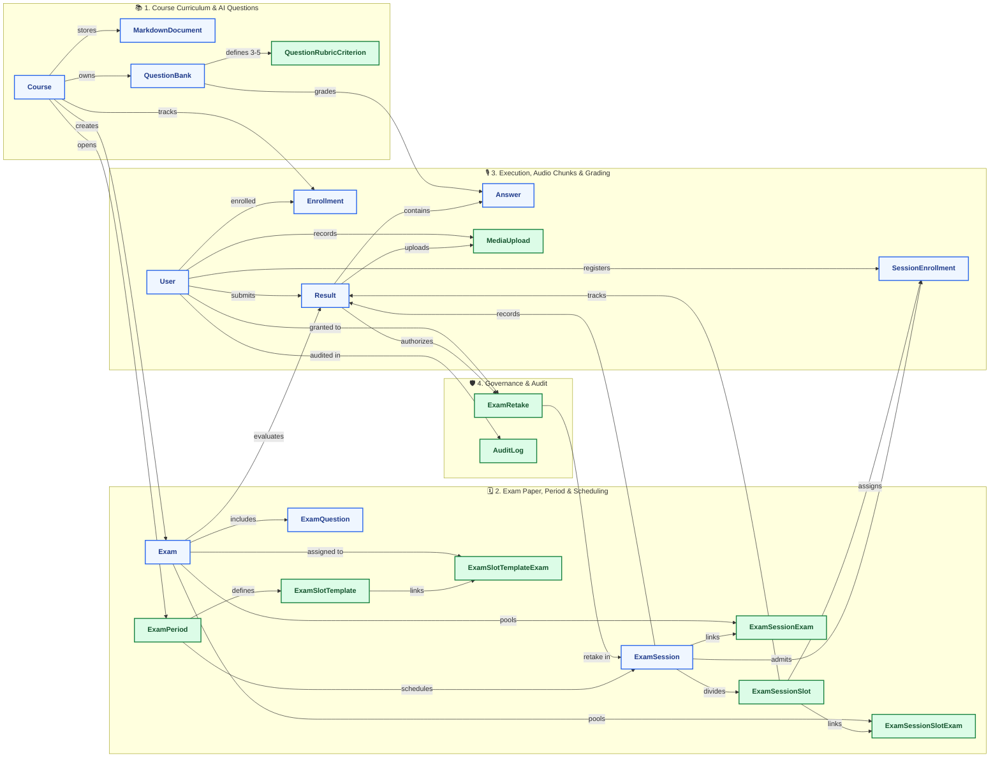
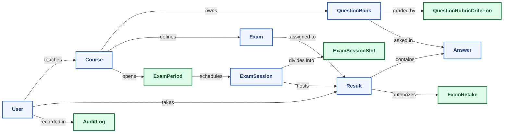
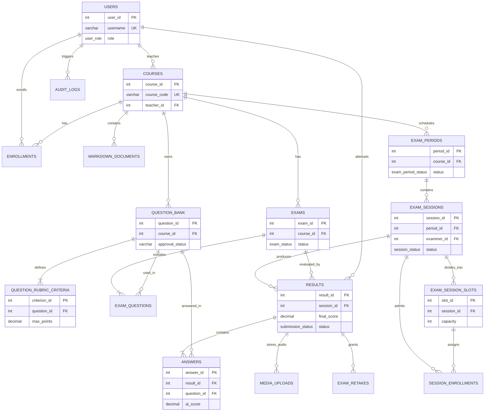

# AIVES v2.0 — Complete 21-Entity ERD Diagrams

## 1. Full 21-Entity Architecture Map (Synced with `AivesDbContext.cs`)

---

## 2. Core 12-Entity High-Level ERD

---

## 3. Formal Crow's Foot ER Diagram (Full 21 Entities)

