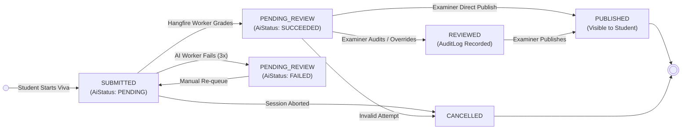
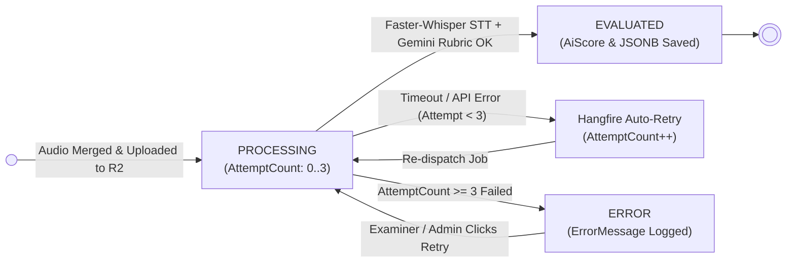
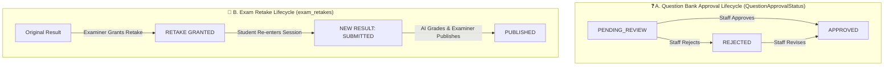

# AIVES v2.0 — Entity Lifecycle & State Machine Diagrams

## 1. Result & AI Grading Lifecycle (`SubmissionStatus` + `AiEvaluationStatus`)

---

## 2. Answer & Hangfire Queue Retry Lifecycle (`AnswerStatus`)

---

## 3. ExamPeriod, Exam & ExamSession Lifecycles

```mermaid
flowchart TB
    subgraph EP["🗓️ A. ExamPeriod Lifecycle (ExamPeriodStatus)"]
        direction LR
        EP_D["DRAFT"] -->|"Staff Activates"| EP_A["ACTIVE"]
        EP_A -->|"Period Ends"| EP_C["COMPLETED"]
        EP_D -->|"Cancel"| EP_X["CANCELLED"]
        EP_A -->|"Cancel"| EP_X
    end

    subgraph EX["📄 B. Exam Paper Lifecycle (ExamStatus)"]
        direction LR
        EX_D["DRAFT"] -->|"Assign to Period/Slot"| EX_S["SCHEDULED"]
        EX_S -->|"Window Opens"| EX_O["OPEN"]
        EX_O -->|"Window Closes"| EX_CL["CLOSED"]
        EX_D -->|"Cancel"| EX_X["CANCELLED"]
        EX_S -->|"Cancel"| EX_X
    end

    subgraph ES["🎙️ C. ExamSession Lifecycle (SessionStatus)"]
        direction LR
        ES_N["NOT_STARTED"] -->|"StartTime Reached / First Student Joins"| ES_I["IN_PROGRESS"]
        ES_I -->|"EndTime Reached / All Finished"| ES_C["COMPLETED"]
        ES_N -->|"Staff Cancels"| ES_X["CANCELLED"]
        ES_I -->|"Emergency Cancel"| ES_X
    end
```

---

## 4. Question Approval & Exam Retake Lifecycles

