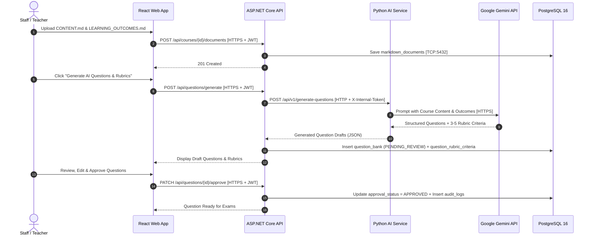
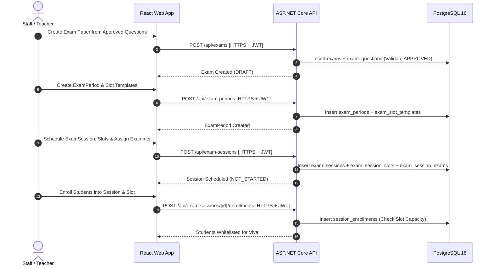
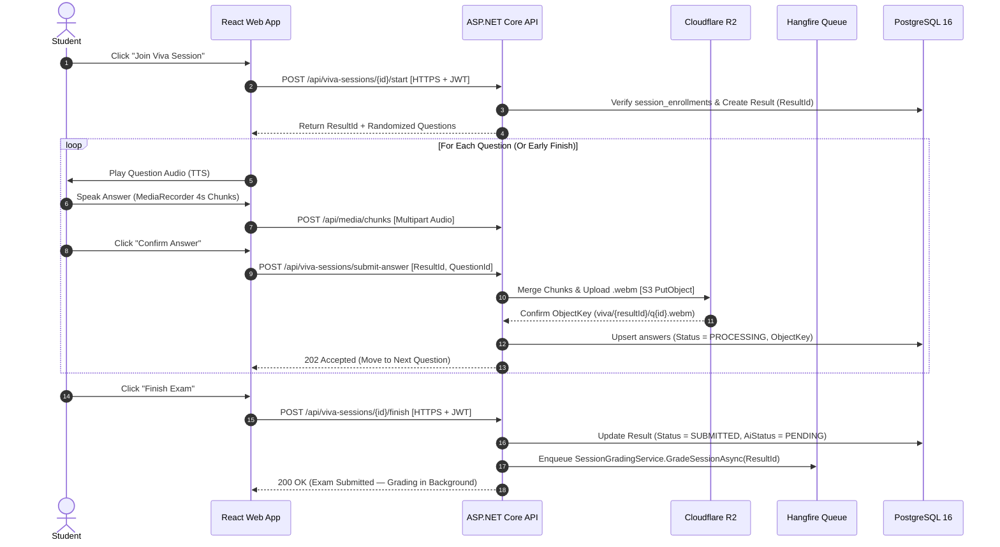
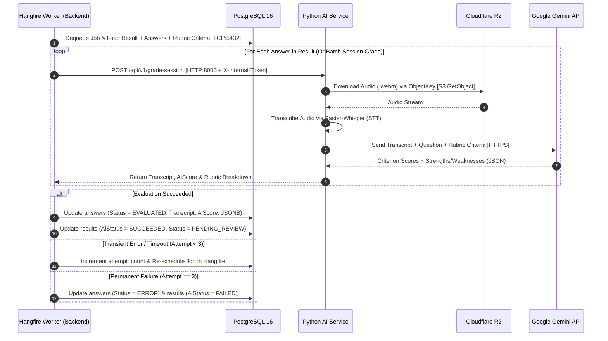
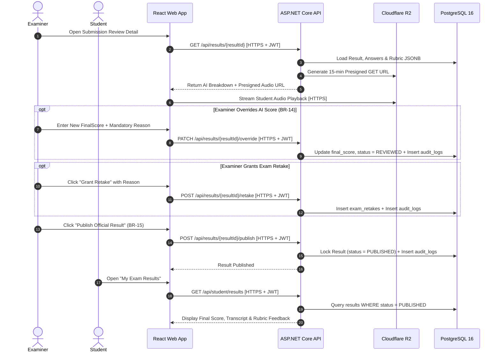
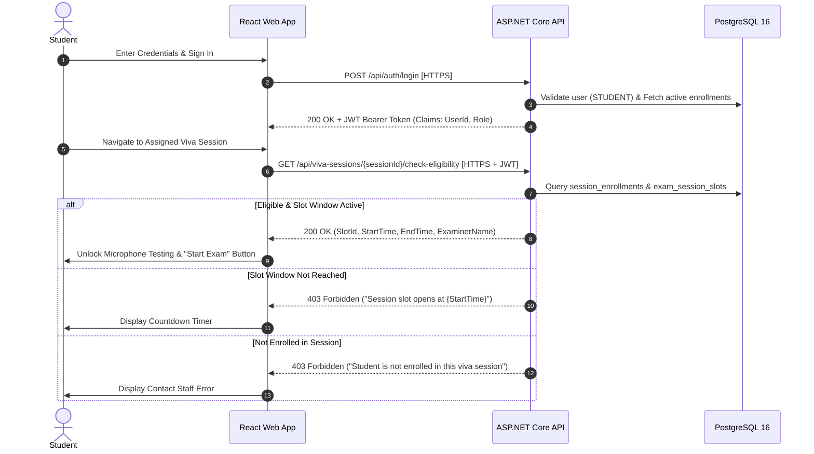
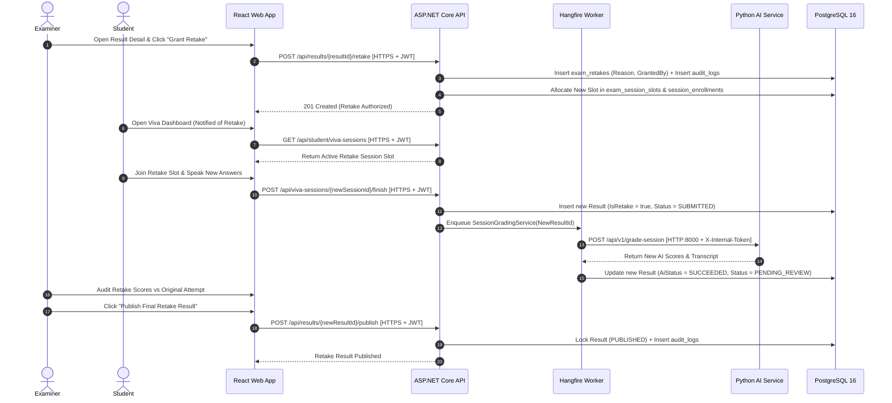

# AIVES v2.0 — Complete Sequence Diagrams (5 End-to-End Flows)

## Sequence 1 — Upload Markdown Materials & AI Question/Rubric Generation

---

## Sequence 2 — Exam Paper, ExamPeriod & Multi-Slot Session Scheduling

---

## Sequence 3 — Live Viva Exam, Chunked Audio Upload to R2 & Queue Dispatch

---

## Sequence 4 — Async Hangfire Queue Worker, Whisper STT & Gemini Rubric Grading

---

## Sequence 5 — Examiner Audio Review, Score Override, Retake Grant & Grade Publication

---

## Sequence 6 — Student Pre-Exam Authentication & Slot Verification

---

## Sequence 7 — End-to-End Retake Workflow (Grant, Slot Re-allocation & Re-grading)

