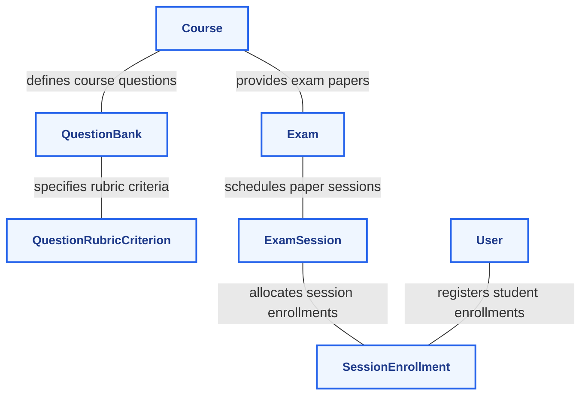
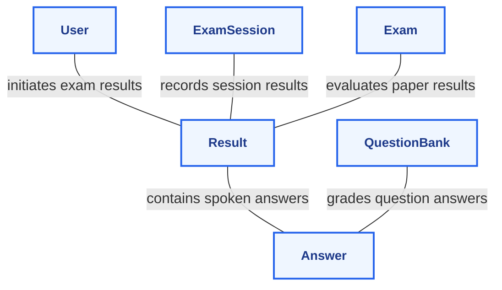
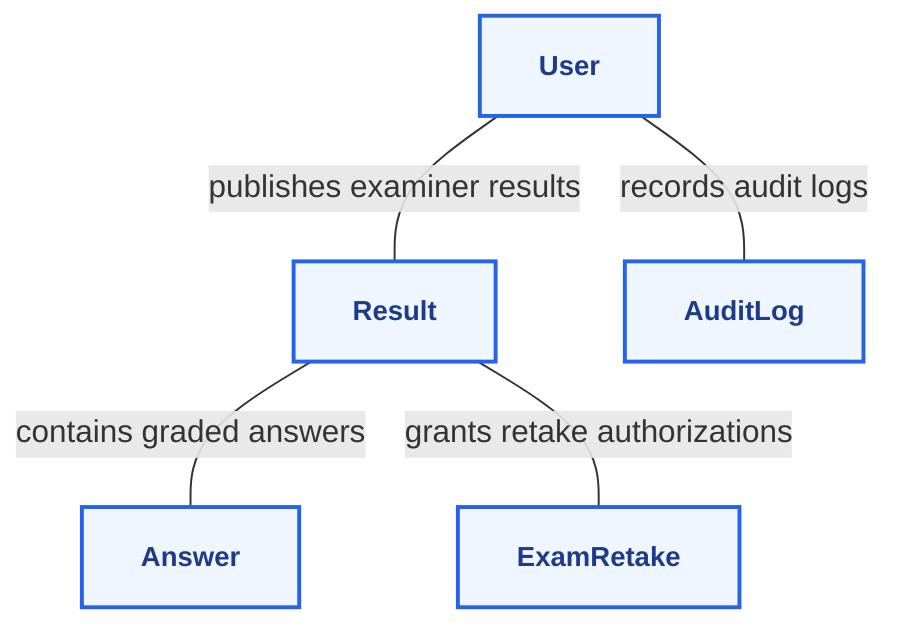

# AIVES v2.0 — Static Workflow Data Models (WF-01, WF-02, WF-03)

> **Static Modeling Standards**:
> - **Nodes (Entities)**: Static entity names consistent across the system.
> - **Associations (Undirected Lines)**: In static structural modeling, connections use **undirected association lines (`---`) without arrowheads**, labeled with `Verb + Target Entity + Scope`.

---

## 1. WF-01: Prepare and Schedule an Examination

---

## 2. WF-02: Complete a Scheduled Viva

---

## 3. WF-03: Review and Publish an Official Result

